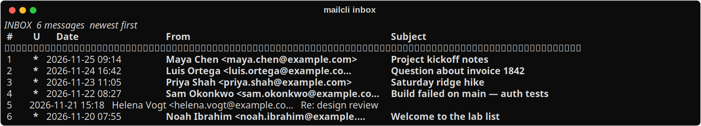

# mailcli

mailcli is an original terminal email client for [Proton Mail Bridge](https://proton.me/mail/bridge). It is not a port of NeoMutt, Mutt, or any other mail client. IMAP and SMTP use the Python standard library (`imaplib`, `smtplib`, `email`, `ssl`). It runs in Windows PowerShell 5.1 and later, with no WSL or MSYS2.

`rich` is optional. When it is installed and stdout is a terminal, `inbox` and `search` draw a table. Otherwise mailcli prints aligned columns.



## Requirements

- Python 3.9 or newer. On Windows, install it from [python.org](https://www.python.org/downloads/) and enable “Add python.exe to PATH”.
- Proton Mail Bridge, which requires a paid Proton plan (Mail Plus, Proton Unlimited, or a business plan). The free plan does not include Bridge.
- Bridge running locally. The usual endpoints are IMAP `127.0.0.1:1143` and SMTP `127.0.0.1:1025`, both with STARTTLS. Bridge uses a certificate it generated itself.

## Install (PowerShell)

From the repository root:

```powershell
py -3 -m pip install -e .\mailcli
py -3 -m pip install -e ".\mailcli[rich]"
```

`python` works in place of `py -3` when the installer put it on `PATH`. Either command creates a `mailcli` executable. `python -m mailcli` works as well.

Create the config file and edit the account. The sample user is a placeholder:

```powershell
New-Item -ItemType Directory -Force -Path $env:APPDATA\mailcli
Copy-Item .\mailcli\config.example $env:APPDATA\mailcli\config
notepad $env:APPDATA\mailcli\config
```

Set the Bridge mailbox password for this session. This is the password Bridge shows for the account, not the password you use on proton.me, and mailcli never writes it to disk or to its own output:

```powershell
$env:MAILCLI_PASSWORD = "paste-the-bridge-password"
mailcli inbox
```

On Linux and macOS the same install is `pip install -e ./mailcli`, and the config file is `~/.config/mailcli/config` (or `$XDG_CONFIG_HOME/mailcli/config`).

## Proton Mail Bridge

1. Subscribe to a Proton plan that includes Bridge, install Bridge, and sign in.
2. Leave Bridge running. In its settings, confirm IMAP and SMTP are enabled. The defaults are `127.0.0.1` port `1143` (IMAP) and port `1025` (SMTP). Both expect STARTTLS, not implicit TLS.
3. Copy the account address into `user`. Copy the Bridge mailbox password into `MAILCLI_PASSWORD` only. Do not pass the password as a command-line argument; shell history would keep it.
4. Bridge’s certificate is self-signed. Either:
   - export the certificate from Bridge and set `tls_cert` to that PEM file (verification stays on), or
   - set `tls_verify = false`, which mailcli accepts only when `host` is `127.0.0.1`, `localhost`, or `::1`.

`--insecure-localhost` is the same loopback-only switch for one invocation. Pointing it at any other host is an error.

`security` is `starttls` by default. Set it to `ssl` (or pass `--security ssl`) for a server that speaks implicit TLS on the IMAP and SMTP ports instead of STARTTLS. Bridge does not use that mode.

A relative `tls_cert` path is resolved next to the config file. When `tls_cert` is set, that file is the trust anchor and verification stays on even if `tls_verify` is false.

## Commands

```powershell
mailcli inbox
mailcli inbox --limit 10 --folder INBOX
mailcli read 1
mailcli folders
mailcli search "invoice"
mailcli send --to friend@example.com --subject "Hello" --body "Hi from mailcli"
Get-Content .\note.txt | mailcli send --to friend@example.com --subject "Notes"
mailcli send --to friend@example.com --subject "Notes" --body-file .\note.txt
```

`inbox` numbers messages newest first. `1` is the newest message in the folder, including mail past `--limit`. `*` in the `U` column means the message is unread. Listing does not mark mail as read. `read` does.

`read` prints From, To, Cc, Date, and Subject, then a plain-text body. Charsets and RFC 2047 encoded words are decoded. An HTML-only message is rendered as text. Attachments are listed with their type and size and are not written out.

`search` asks the server for the text and prints hits with the same numbers `read` uses.

With no subcommand, mailcli opens a prompt loop (no curses, so it works in PowerShell):

```text
1        open that row
b        back to the list
n / p    next or previous message
r        refresh
s TEXT   search
f        list folders
g FOLDER switch folder
c        compose (end the body with a line that is only a period)
q        quit
```

Useful overrides: `--config`, `--host`, `--imap-port`, `--smtp-port`, `--user`, `--folder`, `--tls-cert`, `--insecure-localhost`, `--plain`.

## Configuration

TOML and INI both work. Keys are `host`, `imap_port`, `smtp_port`, `user`, `tls_verify`, `tls_cert`, `security` (`starttls` or `ssl`), `folder`, and `timeout`. A `password` key is refused.

Environment variables, when set, override the file: `MAILCLI_HOST`, `MAILCLI_IMAP_PORT`, `MAILCLI_SMTP_PORT`, `MAILCLI_USER`, `MAILCLI_TLS_VERIFY`, `MAILCLI_TLS_CERT`, `MAILCLI_FOLDER`. The password is only `MAILCLI_PASSWORD`. If that variable is unset and stdin is a terminal, mailcli prompts with `getpass` and does not echo the password.

## Tests

The tests start an in-process IMAP server and SMTP server on `127.0.0.1`, with STARTTLS and a temporary self-signed certificate. No external mail service is used.

```powershell
py -3 -m pip install -e ".\mailcli[dev]"
cd mailcli
py -3 -m pytest
```

## Demo

`docs/demo.txt` is a transcript of `inbox`, `read`, `send`, and `inbox` again. The mailbox was GreenMail 2.1.15 with a local account, `demo@localhost`. That GreenMail build speaks implicit TLS rather than STARTTLS, so the demo used `security = ssl` against its IMAPS and SMTPS ports. Proton Mail Bridge stays on the default `starttls` mode, which the pytest suite exercises with a local certificate. `docs/inbox.png` is the same six-message inbox drawn with the optional table. Nothing in the transcript is a real mailbox.
